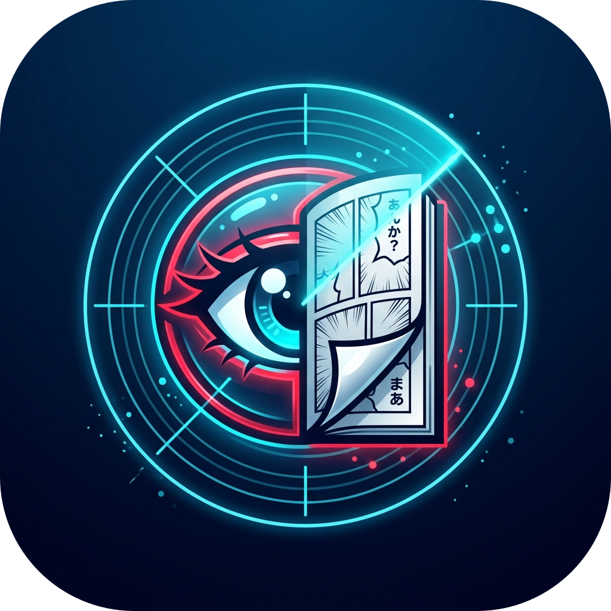
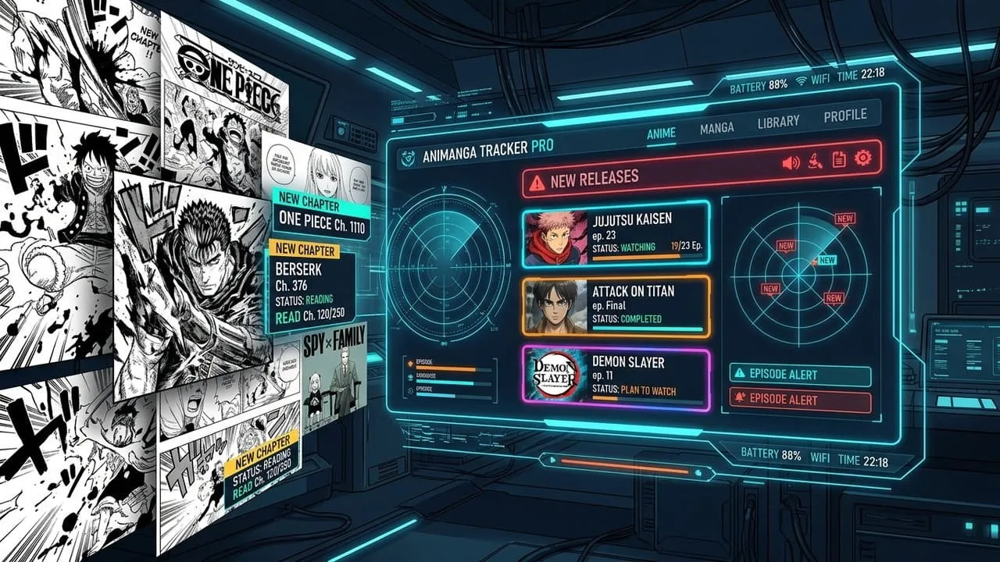

<p align="center">
  
</p>

<h1 align="center">Check Anime & Scans</h1>

<p align="center">
  <strong>Écosystème moderne pour suivre et vérifier automatiquement les sorties d'animes et de scans (Extension Chrome MV3, PWA Mobile tactile & Scraper Cloud).</strong>
</p>

<p align="center">
  
  
  
  
</p>

<p align="center">
  
</p>

---

## 🌟 Vue d'Ensemble de l'Écosystème

Check Anime & Scans propose une architecture complète sans serveur (*serverless*) pour synchroniser vos lectures et visionnages entre vos appareils :

1. **Extension Chrome Desktop (Manifest V3)** :
   - Détection et suivi automatique de vos favoris Chrome (`ANIMES`, `SCANS` ou dossiers personnalisés).
   - Scraping parallèle haute performance avec limitation de concurrence et timeout sécurisé.
   - Badge numérique discret sur l'icône et alertes système.

2. **Application Mobile Tactile (PWA autonome)** :
   - Interface web installable sur smartphone (Android / iOS) et desktop.
   - Gestion des lectures : marquage rapide (+1, valider lu, édition manuelle du chapitre).
   - Synchronisation bidirectionnelle fluide via GitHub Gist (`suivi.json`) avec file d'attente debouncée et support hors-ligne (Background Sync).
   - Geste naturel *Pull-to-Refresh* tactile avec retour haptique pour actualiser les scans sans recharger la page.
   - Prise en charge native du bouton retour Android via l'historique popstate pour la fermeture des modales.

3. **Lecteur Radio d'Ambiance Zen (24/7)** :
   - Intégré directement dans la PWA avec lecture continue en tâche de fond.
   - Flux web radios 100% indépendants et garantis sans coupures publicitaires (*Stereo Anime* & *Nightwave Plaza*).
   - Contrôles déportés sur l'écran de verrouillage et le centre de contrôle mobile (`navigator.mediaSession`).
   - Reconnexion automatique au retour du réseau (sorties de tunnels, métro).
   - Délégation complète du volume au mixeur matériel du téléphone.

4. **Robot de Scraping Cloud (GitHub Actions)** :
   - Analyse périodique programmée toutes les 3 heures (`.github/workflows/check-scans.yml`).
   - Détection automatique des nouveaux épisodes/scans même quand votre navigateur est fermé.
   - Envoi de notifications Web Push chiffrées (VAPID / `web-push`).

---

## 🚀 Installation & Utilisation

### Extension Google Chrome (PC / Mac)

1. Clonez le dépôt :
   ```bash
   git clone git@github.com:Lionization/Check-Anime-Scan.git
   ```
2. Ouvrez Google Chrome et accédez à `chrome://extensions/`.
3. Activez le **Mode développeur** (en haut à droite).
4. Cliquez sur **Charger l'extension non empaquetée** et sélectionnez le dossier racine du projet.
5. Dans la page d'options de l'extension, renseignez votre **Gist ID** et votre **GitHub Token** (scope `gist`).

### Application Mobile PWA (Smartphone)

1. Déployez le contenu du dossier `pwa/` sur un hébergement HTTPS (ex: GitHub Pages).
2. Ouvrez l'URL dans votre navigateur mobile (Chrome ou Safari).
3. Cliquez sur **Ajouter à l'écran d'accueil** (ou *Installer l'application*).
4. Accédez aux réglages de la PWA et entrez le même **Gist ID** et **Token** pour synchroniser instantanément vos lectures.

---

## 📁 Architecture du Projet

```text
check-anime-scan/
├── .agents/             # Directives et documentation interne pour assistants IA (AGENTS.md)
├── .github/workflows/   # Workflow GitHub Actions (scraping périodique toutes les 3h)
├── assets/              # Visuels HD (logo transparent, bannière hero)
├── background/          # Logique d'arrière-plan de l'extension Chrome
│   ├── adapters/        # Scrapers DOM dédiés (anime-sama.js, webtoons.js, mangago.js)
│   ├── gist-sync.js     # Synchronisation bidirectionnelle Gist et réconciliation des lectures
│   └── service-worker.js# Gestionnaire d'alarmes et de badge d'extension
├── icons/               # Déclinaisons d'icônes (16px, 48px, 128px, 500px)
├── options/             # Page de réglages de l'extension Chrome
├── popup/               # Interface popup de l'extension Chrome (HTML/CSS/JS)
├── pwa/                 # Progressive Web App autonome mobile
│   ├── app.css          # Styles CSS3 Vanilla, thème sombre et animations fluides
│   ├── app.js           # Client PWA, file d'attente Gist, lecteur zen et synchronisation
│   ├── index.html       # Gabarit HTML5 sémantique de l'application mobile
│   ├── manifest.json    # Manifest Web App pour installation PWA
│   ├── sw.js            # Service Worker PWA (stratégie Network-First et cache versionné)
│   └── version.js       # Source unique de vérité de la version applicative
├── scripts/             # Scripts autonomes (cloud-scraper.mjs pour GitHub Actions)
├── test-adapters.mjs    # Suite de tests automatisés exhaustive (10 contrôles stricts)
├── utils.js             # Utilitaires isomorphes partagés (extraction de numéros, décodage, dates)
├── manifest.json        # Déclaration de l'extension Chrome MV3
└── package.json         # Dépendances et script de test npm
```

---

## 🧪 Tests & Contrôle Qualité

Le projet intègre une suite de tests unitaires et d'intégration stricte sans dépendance lourde (`node:assert/strict`).

Pour lancer la validation complète :
```bash
npm test
```

La suite exécute automatiquement :
1. Le contrôle syntaxique de l'ensemble des fichiers JavaScript (`node -c`).
2. Les tests des adaptateurs de scraping (*Anime-Sama*, *Webtoons*, *Mangago*) en cas nominaux et dégradés.
3. La validation du décodage d'entités HTML et de l'assainissement des titres.
4. L'extraction précise des numéros d'épisodes et chapitres (entiers, décimaux et balises masquées).
5. La logique métier anti-régression de détection de non-lus (`isItemUnread`).
6. La normalisation des clés d'URL pour la synchronisation Gist (`normalizeUrlKey`).
7. Le formatage temporel relatif en français.
8. La limitation de concurrence asynchrone et la résilience aux pannes réseau (`runWithConcurrency`).

---

## 📄 Licence

Projet distribué sous licence MIT. Développé par [Lionization](https://github.com/Lionization).
